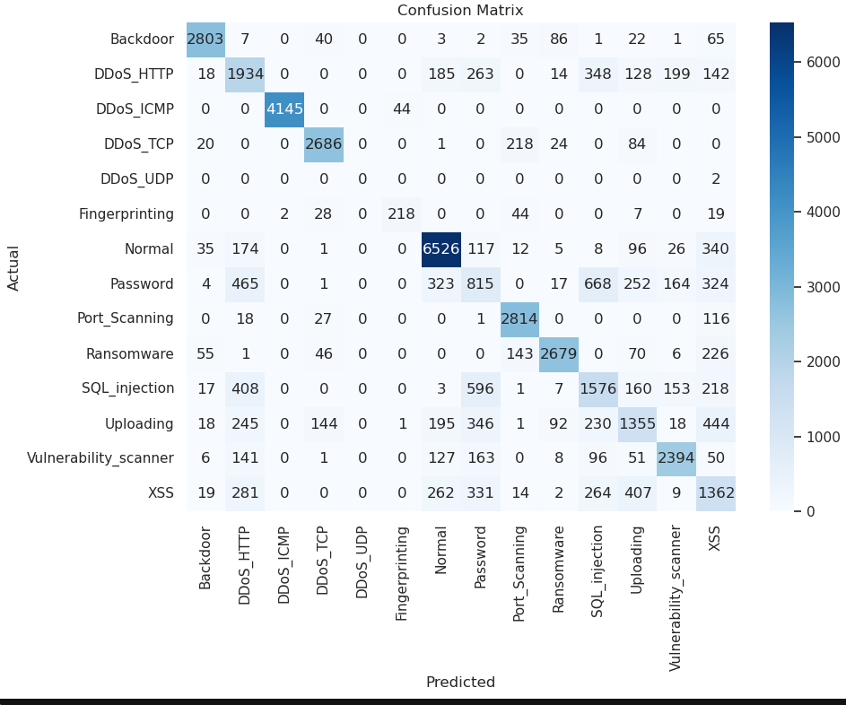
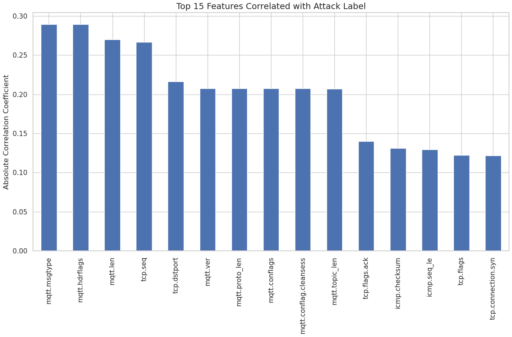
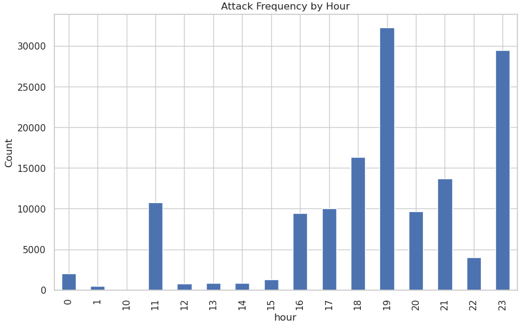

# AI-Based Intrusion Detection and Data Poisoning

A machine learning project exploring network intrusion detection and the impact of data-poisoning attacks on classification models.

The project uses the Edge-IIoTset cybersecurity dataset to investigate how machine learning can distinguish between normal network activity and malicious traffic, evaluate different classification algorithms, and examine how manipulated training labels can affect model performance.

## Overview

Intrusion detection systems help identify suspicious activity in networks and connected devices. Machine learning offers a way to detect patterns in network traffic, but the reliability of these systems depends on the quality and integrity of their training data.

This project explores two related problems:

- **Intrusion detection:** Training and evaluating machine learning classifiers on network security data.
- **Data poisoning:** Simulating label manipulation to investigate how corrupted training data can affect detection performance.







## Features

- Data loading, exploration and preprocessing using pandas and NumPy.
- Feature encoding and scaling where appropriate.
- Training and comparison of multiple machine learning classifiers.
- Evaluation using classification metrics and confusion matrices.
- Feature importance analysis to investigate which inputs influence model predictions.
- Simulated label-poisoning experiments to explore model robustness.
- Comparison of model behaviour under different training-data conditions.

## Dataset

The project uses **Edge-IIoTset**, a dataset developed for cybersecurity research involving Industrial Internet of Things (IIoT) environments.

The dataset contains network traffic and attack-related data suitable for investigating intrusion detection and machine learning-based security approaches.

Dataset source: [Edge-IIoTset](https://ieee-dataport.org/documents/edge-iiotset-new-comprehensive-realistic-cyber-security-dataset-iot-and-iiot-applications)

Refer to the dataset's documentation and original research for details about its collection, features, attack categories and intended use.

> The dataset is used for academic experimentation. Results on a benchmark dataset do not necessarily represent performance on live networks.

## Machine Learning Models

The project explores the following classification algorithms:

- K-Nearest Neighbours (KNN)
- Random Forest
- Stochastic Gradient Descent (SGD) classifier
- Multi-Layer Perceptron (MLP)

The models provide different approaches to learning patterns in network data, from distance-based classification to ensemble learning and neural networks.

## Methodology

### 1. Data preprocessing

The dataset is prepared for machine learning through appropriate feature processing, encoding of categorical variables and scaling where required by the selected algorithms.

### 2. Model training

The selected classifiers are trained on the prepared data to learn patterns associated with normal and malicious network activity.

### 3. Model evaluation

Model performance is assessed using classification metrics and confusion matrices. These help examine overall performance as well as the types of classification errors made by each model.

### 4. Feature importance

Feature importance analysis is used to investigate which input features contribute to model predictions. The interpretation depends on the model and the feature-importance method used.

### 5. Data-poisoning experiments

Training labels are deliberately manipulated to simulate a data-poisoning scenario. The resulting models are evaluated to investigate whether corrupted labels affect classification performance.

The experiment focuses on the effects of the simulated manipulation; it does not establish resistance to every type of poisoning attack.

## Evaluation

The project uses classification metrics such as:

- Accuracy
- Precision
- Recall
- F1-score
- Confusion matrices

For intrusion detection, accuracy alone can be misleading, particularly when classes are imbalanced. Precision and recall help provide a more detailed view of false alarms and missed attacks.

## Installation

Clone the repository:

```bash
git clone https://github.com/zagyarakushi/AI-Based-Intrusion-Detection-and-Data-Poisoning.git
cd AI-Based-Intrusion-Detection-and-Data-Poisoning
```

## Usage

Open the project's notebook and execute the cells in order.

## Limitations

- Results depend on the dataset, preprocessing choices, class distribution and evaluation methodology.
- Benchmark performance does not guarantee effectiveness against previously unseen attacks or real-world network traffic.
- Simulated label poisoning represents a particular experimental scenario rather than the full range of possible data-poisoning attacks.
- Feature importance indicates relationships learned by a model and does not necessarily establish causation.
- Model comparisons are meaningful only when the evaluation procedures and data splits are appropriately controlled.

## Future Improvements

- Evaluate robustness across different poisoning rates and attack strategies.
- Compare performance before and after data poisoning.
- Investigate class imbalance and per-attack detection performance.
- Test generalisation using separate or previously unseen data.
- Explore additional intrusion detection models and explainability techniques.
- Improve reproducibility through documented configurations, fixed random seeds and automated experiments.

## Technologies

- Python
- pandas
- NumPy
- scikit-learn
- Matplotlib / Seaborn, if used
- Jupyter Notebook, if used

## Disclaimer

This project is intended for educational and research purposes. Experiments involving data poisoning are conducted to study machine learning robustness and should not be interpreted as a guarantee of security in operational intrusion detection systems.

## Author

**Charles Buckley**

GitHub: [@zagyarakushi](https://github.com/zagyarakushi)
